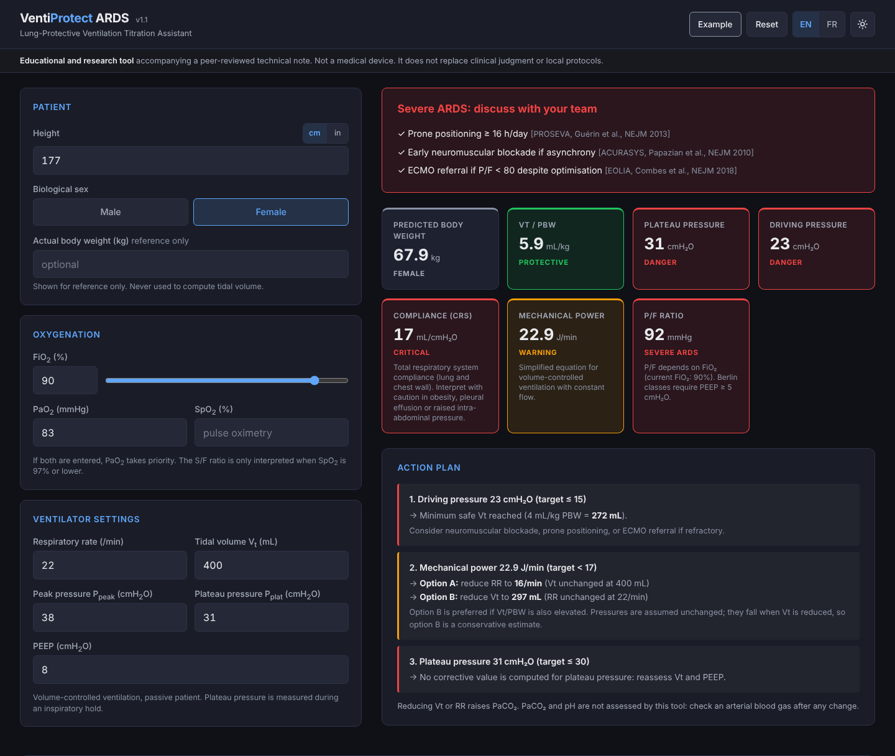

# VentiProtect ARDS

**Lung-Protective Ventilation Titration Assistant**

VentiProtect ARDS is a single-page calculator for lung-protective ventilation in medical Acute Respiratory Distress Syndrome (ARDS). It was built as a proof of concept for physician prompt engineering and is described in:

> Rozencwajg S. VentiProtect ARDS, vibe coding lung protection: a five-minute clinician-built ventilator tool as proof-of-concept for physician prompt engineering. *Anaesth Crit Care Pain Med* 2026:101934. [doi:10.1016/j.accpm.2026.101934](https://doi.org/10.1016/j.accpm.2026.101934)

**Use it online:** https://www.sacha-rozencwajg.fr/ventiprotect/



## Two versions

| Version | File | What it is |
|---|---|---|
| **v1.1** | [`web/index.html`](web/index.html) | The version to use. Corrected formulas, input checks, English and French, works on a phone. |
| **v1.0** | [`app/index.html`](app/index.html) | The version described in the article, exactly as generated. Kept unchanged for reproducibility. Do not edit it. |

Both are a single HTML file with no dependency. Open the file in any browser: no installation, no server, no internet connection.

## What it computes

- **Predicted body weight** and **tidal volume per kg** of predicted body weight (target ≤ 6 mL/kg)
- **Plateau pressure**, **driving pressure** and **respiratory system compliance**
- **Mechanical power**
- **Oxygenation**: P/F ratio from PaO₂, or S/F ratio from SpO₂ when no blood gas is entered
- An **action plan** with computed corrections (tidal volume or respiratory rate to reach each target) and a reminder of the options to discuss in severe ARDS

Formulas, thresholds and references are listed in the page itself, under "About this tool".

## What changed in v1.1

- **Mechanical power** uses the published simplified equation, `0.098 × RR × Vt × (Ppeak − ½ × (Pplat − PEEP))`, which needs the peak pressure. v1.0 computed `0.098 × RR × Vt × (Pplat − PEEP/2)`.
- **S/F thresholds** are 148, 235 and 315 (Rice et al., *Chest* 2007), and the ratio is only interpreted for SpO₂ ≤ 97%. v1.0 used 146, 236 and 296.
- **Plateau pressure** has its own card and alert.
- **Input checks.** Values outside the accepted ranges and inconsistent pressures are reported as errors, and nothing is computed from them. FiO₂ no longer has a default value.
- No Berlin class is shown when PEEP is below 5 cmH₂O.
- The "all parameters protective" message only appears when every ventilator input is present and every alert is green.
- Suggested values are rounded towards the protective side.
- Height in cm or inches, English and French, light and dark themes, results summary on small screens.
- No web font: the page makes no network request, and a content security policy enforces it.

## Privacy

Everything is computed in the browser. Nothing is stored, nothing is sent, and there is no analytics. No patient-identifying data is needed.

## Repository layout

| Path | Content |
|---|---|
| `web/index.html` | v1.1, the current version |
| `app/index.html` | v1.0, the published version (frozen) |
| `supplementary/` | Pre-prompt reasoning transcript and final prompt used to generate v1.0 |
| `tests/test_engine.mjs` | v1.1 tests. They load the calculation code straight from `web/index.html` and run it. |
| `tests/test_ventiprotect.py` | v1.0 verification suite described in the article (100 scenarios, 1,400 checks) |
| `tests/test_report_100.txt` | Report of the v1.0 suite |

## Running the tests

```bash
node --test tests/test_engine.mjs
```

```bash
python3 tests/test_ventiprotect.py
```

The first command needs Node.js 18 or later and nothing else. It also checks that `app/index.html` is still the published file, byte for byte.

## Changing v1.1

The calculation code lives in one block of `web/index.html` (`<script id="vp-engine">`), separate from the interface. Thresholds are defined once, at the top of that block. After any change, run the tests.

## Author

**Sacha Rozencwajg, MD**  
Anesthesiologist-Intensivist  
Hôpital Marie-Lannelongue / GH Paris Saint-Joseph  
INSERM U1358, Université Paris-Saclay

## Licence

MIT. Free to reuse and adapt.

---

**Disclaimer:** VentiProtect ARDS is an educational and research tool. It is not a medical device and **does not replace expert clinical judgment**. Always assess patients individually and follow local protocols.
